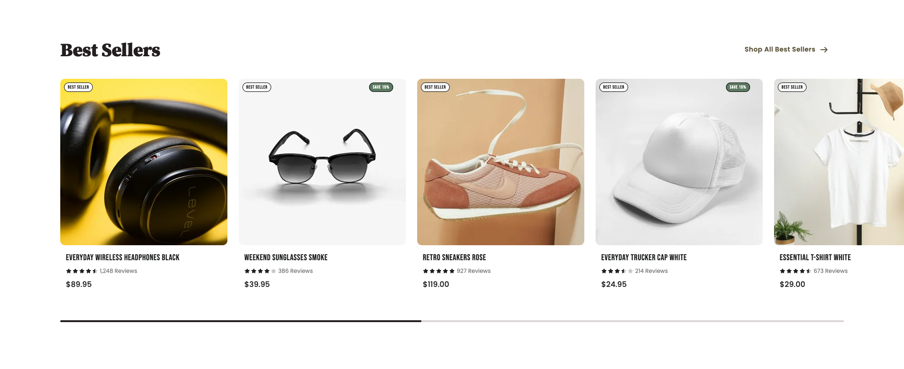
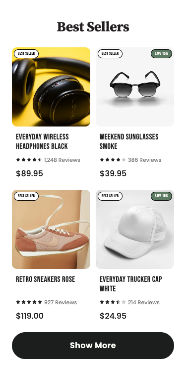

# Platter technical challenge

**Live preview:** [View the challenge](https://asaelx.github.io/platter-technical-challenge/).

**Shopify bonus:** [View the demo store](https://platter-challenge-demo.myshopify.com/pages/platter-challenge-demo?preview_theme_id=186312655071&view=platter-demo). Storefront password: `sheuts`.

I'm Asael Chavez, and this project is my submission for the technical challenge as part of my application to Platter.

The challenge is to recreate the supplied Figma featured collection across desktop and mobile, including product cards, secondary images on hover, mobile expansion, and a horizontal collection scrollbar.

## Screenshots

Desktop · 1920 × 787

Mobile · 375 × 757, showing the initial four products

## My approach

I started by comparing the desktop and mobile references, identifying the shared visual rules and the places where product content differed. I preserved the typography, colors, spacing, and visual hierarchy, then made explicit decisions about content consistency and behavior between the supplied viewport sizes.

I built the collection with semantic HTML, Tailwind CSS, and Vanilla JavaScript. Product cards use a consistent structure and shared styles, while JavaScript handles expansion and scrolling. The interaction work includes keyboard access, visible focus, reduced-motion preferences, and focus recovery when resizing changes which controls or products are visible. All products remain available if JavaScript is disabled.

For performance, I supplied responsive WebP images with explicit dimensions and locally hosted WOFF2 fonts. This keeps image space reserved while assets load and avoids external image or font requests. I checked the supplied reference widths and intermediate sizes, including repeated interaction and resizing, to verify behavior beyond the two static designs.

The project is delivered as a static page with generated CSS included. Reviewers can open `index.html` directly in a browser; no installation or build step is required.

## Design decisions

The Figma references contain a few differences between layouts and some sample content that does not describe the pictured products. I treated these as decisions to resolve explicitly and kept each product's information consistent across desktop and mobile.

| Observation in Figma | Decision in this submission |
| --- | --- |
| Some titles do not match the images: headphones are labeled as a T-shirt, and sunglasses as a bottle. | I selected Unsplash photos and wrote full titles that describe the products shown. Related secondary photos may depict a different model because these are stock placeholders. |
| The second title includes “Forest Green” on desktop but omits it on mobile. | Each product keeps its full title at every width, with wrapping handled by the layout. |
| SAVE 15% appears on cards 2 and 4 on desktop, but cards 2 and 3 on mobile. | Sale badges stay on cards 2 and 4 at every width. BEST SELLER remains on all ten cards. |
| Desktop ratings include partial stars, while mobile shows full stars. | Each product has one rating, including half stars where applicable, shared across layouts. |
| Visible cards repeat the same $104.95 price and 1,234 review count. | I used varied sample prices, review counts, and ratings to exercise the cards with more representative content. These values remain the same across layouts. |

The desktop scrollbar thumb also reflects the actual visible proportion of the ten-product collection, so its width changes with the viewport rather than remaining fixed to the reference artwork.

In a production project, I would confirm content discrepancies and promotion rules with the designer or merchant before implementing them. A layout change should preserve the identity, price, rating, and promotion eligibility of the product being displayed.

### Product data in a production store

The HTML version uses static sample content to keep the main challenge self-contained. For a real storefront, I would render titles, product URLs, images, and prices from the commerce platform, such as Shopify, or a product API. Ratings and review counts would come from the connected review provider. The same underlying product data would serve every layout. The Shopify bonus below demonstrates rendering from a store catalog with sample products.

Sale labels would follow actual pricing and promotion rules, including the applicable variant and currency; best-seller labels would follow the merchant's merchandising criteria. The HTML version's placeholder values and badges demonstrate presentation without a catalog connection; the Shopify bonus applies these rules to its sample catalog. Primary and secondary photos in production would belong to the same real product, with appropriate image alternatives and responsive sizes.

## Challenge checklist

- [x] Recreate the supplied design, with the approved product content and image substitutions.
- [x] Include at least ten product cards.
- [x] Initially show only the first four products on mobile.
- [x] Provide a mobile-only Show More button that smoothly reveals the remaining six products.
- [x] Swap to a secondary product image on hover-capable devices.
- [x] Use free Unsplash stock images as placeholders.
- [x] Build with HTML, Tailwind CSS, and JavaScript.
- [x] Use well-structured, semantic HTML.
- [x] Use plain Vanilla JavaScript for functionality.
- [x] Make the layout responsive across desktop and mobile.
- [x] Increase the scrollbar thumb to 6px on hover or touch.
- [x] Create a Git repository with meaningful commits showing the development process.
- [x] Provide the [completed GitHub repository](https://github.com/asaelx/platter-technical-challenge).
- [x] Provide a [pure HTML live preview](https://asaelx.github.io/platter-technical-challenge/).
- [x] Require no installation or local build step to review the final result.
- [x] Optional bonus: migrate to a Shopify section using Liquid and schema inputs on a development store.
- [x] Provide a [Shopify demo preview](https://platter-challenge-demo.myshopify.com/pages/platter-challenge-demo?preview_theme_id=186312655071&view=platter-demo), with storefront password `sheuts`.

## Shopify bonus

I migrated the collection into a configurable [Liquid section](shopify/sections/platter-featured-collection.liquid), with a reusable [product card snippet](shopify/snippets/platter-product-card.liquid). The Shopify implementation lives in [`shopify`](shopify), preserving the independent HTML submission and its hosted preview.

The demo uses an unpublished **Platter Challenge Preview** theme. Its dedicated `platter-demo` page template displays the collection alone, without the surrounding Horizon header and footer, so reviewers can compare it with the HTML version. This template is for demonstration purposes; the section can also be placed within a regular storefront layout. The preview link selects the unpublished theme and template explicitly. Shopify requires password protection on this development store; enter `sheuts` to view it. This is a storefront viewing password, not an admin credential.

### Merchant settings

The section schema exposes four controls in Shopify's theme editor:

| Setting | Demo configuration |
| --- | --- |
| Heading | Best Sellers; a blank heading falls back to the collection title. |
| Collection | Best Sellers, with ten products in the same order as the HTML demo. |
| Collection link label | Shop All Best Sellers. |
| Maximum products | Ten by default; adjustable from four to twenty. |

### Catalog and merchandising rules

Titles, product links, images, and prices come from Shopify rather than duplicated card markup. Product links open the selected or first available variant; the collection link opens the selected collection. The demo catalog uses USD and the same sample content and Unsplash photos as the HTML version. Shopify serves responsive product images through its CDN.

Prices and savings use the same variant. A SAVE badge appears only when its compare-at price exceeds its price, with the percentage calculated and rounded in Liquid. The sunglasses and cap have compare-at prices that produce SAVE 15%. BEST SELLER is controlled by the Boolean product metafield `custom.best_seller`, enabled for all ten demo products.

Ratings and review counts use the `custom.demo_rating` rating metafield and `custom.demo_review_count` integer metafield. These are sample values, not collected customer reviews. Stars display half-star increments, and missing ratings omit the review row. In production, a review provider would supply this data.

### Presentation and verification

The section retains the HTML version's responsive layout, hover-only secondary images, mobile Show More / Show Less, keyboard controls, and reduced-motion handling. Styles and font names are scoped to avoid changing the host theme. Each section instance manages its own interactions and cleans up listeners and observers when Shopify's theme editor unloads it. Empty collections and missing images have explicit fallback content.

The actual development-store preview was checked at 320, 375, 640, 767, 768, 769, 1024, 1280, 1536, and 1920px widths. Checks confirmed no page-level horizontal overflow, the four-product mobile state, expansion and collapse, keyboard scrolling, catalog values, and all twenty product images. The theme editor displayed all four schema controls and the mobile preview. Local checks also covered reduced motion, scrolling input methods, multiple section instances, and editor lifecycle handling. Shopify Theme Check reported no findings for the isolated section package, and the uploaded files matched the committed implementation.

## Product images

The collection contains ten products with consistent titles, prices, ratings, and review counts across desktop and mobile. BEST SELLER badges appear on every card; SAVE 15% badges appear on cards 2 and 4. In the HTML version, product and collection links use `#` placeholders.

Each product has two Unsplash placeholder photos, delivered as locally hosted WebP images in 355px and 710px sizes. Related photos may show different models of the same product type. [Photo credits and source links](assets/images/SOURCES.md) are included.

Hovering over a product image shows its secondary photo on hover-capable devices. Moving the pointer away restores the primary photo. Touch-only devices retain the primary image; no tap interaction is needed to change images.

## Mobile collection

Below 768px at the default browser font size, the collection initially shows four products. Show More reveals the remaining six; Show Less collapses them. The transition lasts 300ms with smooth easing and is immediate when reduced motion is preferred.

The page remembers the mobile expanded or collapsed state when resizing between layouts during the current visit. Desktop always makes all ten products available. Reloading resets the mobile collection to four products.

Collapsed products are excluded from keyboard navigation and screen readers. Focus stays on the toggle when activated; if a resize would hide a focused product, focus moves to the toggle. With JavaScript disabled, all products remain available and the toggle is hidden.

## Desktop scrolling

Drag the scrollbar thumb or click the track to move through the collection. Track clicks center the thumb at the selected position. The thumb reflects the visible proportion of the collection and grows from 4px to 6px on hover or while dragging, including touch dragging. Trackpad and touch scrolling also work directly on the products.

When the scrollbar is focused, arrow keys move one card, Page Up and Page Down move one visible collection width, and Home and End reach either end. Movement is immediate, and the scrollbar exposes its position to assistive technology. The control is hidden on mobile and when all products fit without scrolling. Without JavaScript, native scrolling remains available.

## Fonts

The page uses locally hosted fonts matching the Figma design:

- [Source Serif Pro 3.001](https://github.com/adobe-fonts/source-serif/releases/tag/3.001R): Bold and Black for headings.
- [Bebas Neue](https://fonts.google.com/specimen/Bebas+Neue): Regular for product titles and badges.
- [Poppins](https://fonts.google.com/specimen/Poppins): Regular, Medium, and SemiBold for supporting text and controls.

The WOFF2 files and original SIL Open Font License texts are included in [`assets/fonts`](assets/fonts). Bebas Neue and Poppins use the Latin webfont subsets provided by Google Fonts. No external font requests are needed to view the page.

## Verification

Checked in Chrome at 320, 375, 640, 767, 768, 769, 1024, 1280, 1536, and 1920px widths, with additional intermediate resize checks. The review covered layout overflow, product content, hover images, mobile expansion, keyboard and touch-emulated scrolling, focus handling, and reduced motion.

The page and its local assets loaded successfully both by opening the HTML file directly and through a GitHub Pages-style URL path, with no external runtime requests. Regenerating the CSS produced an exact match with the included stylesheet.
